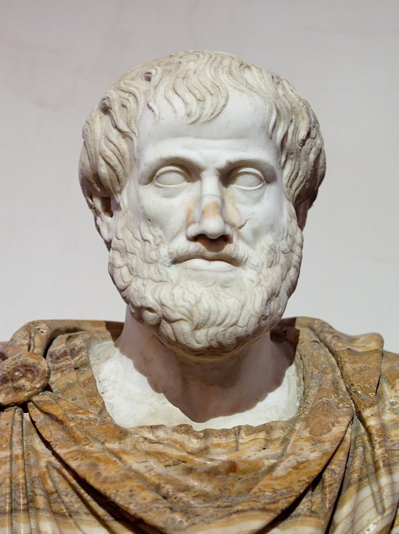
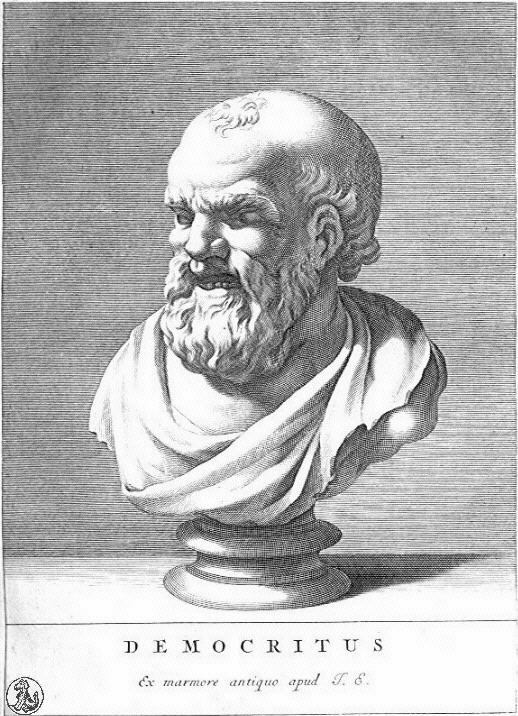
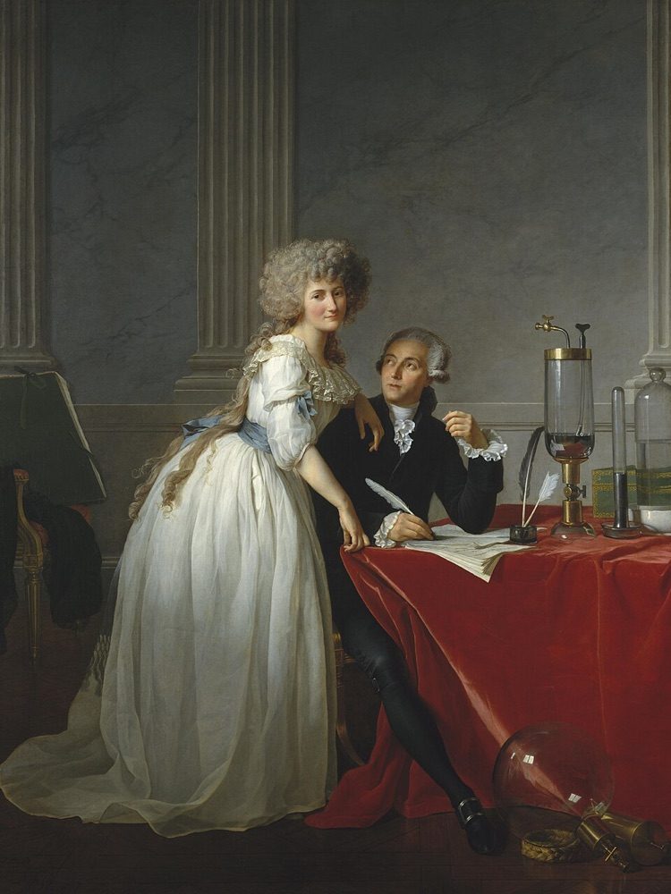
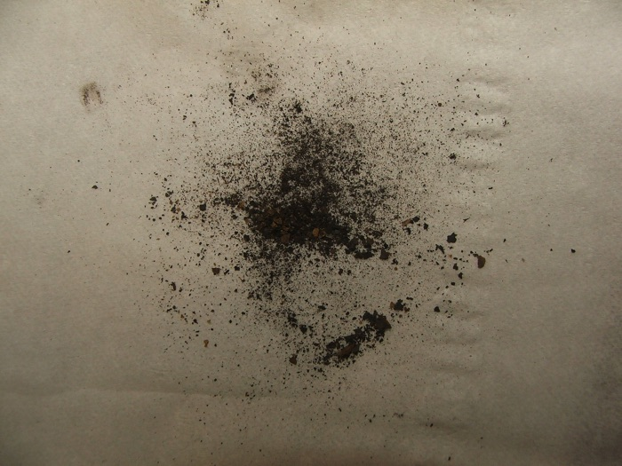
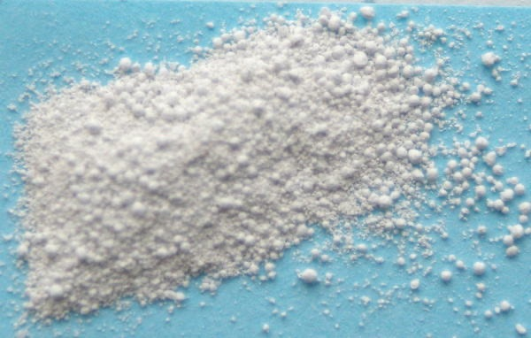
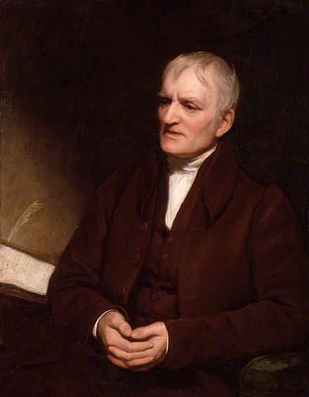
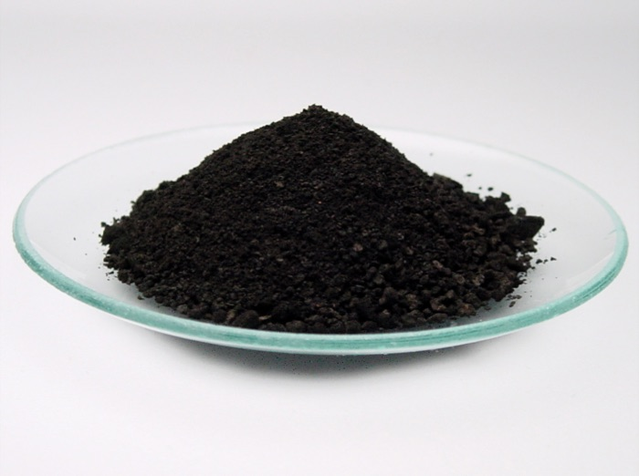
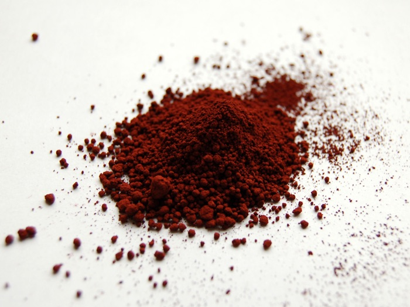
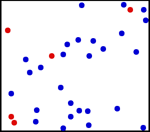
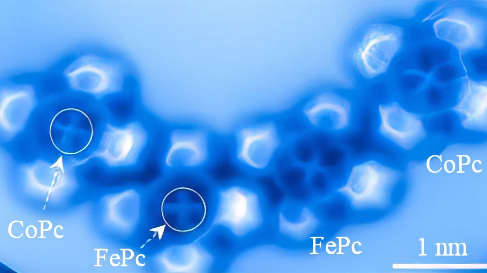

## Атомы

- Атомы — элементы конструктора, из которых строится вещество вокруг нас.
- Размер атома порядка $10^{-10}$ м $= 10^{-4}$ мкм $= 0{,}1$ нм.
- Предел оптического микроскопа порядка $0{,}2$ мкм $= 200$ нм.

::: {.nut-question}
Как узнали про атомы?
:::

## Всё началось… с древних греков

```{=html}
<div class="nut-thinkers">
  <div>
    
    <div class="who">Аристотель, 384 до н. э.</div>
    <div class="quote fragment">«Делить пополам можно до бесконечности»</div>
  </div>
  <div class="nut-apple">
    <svg viewBox="0 0 360 300" aria-hidden="true">
      <defs>
        <linearGradient id="apple-skin" x1="0" y1="0" x2="1" y2="1">
          <stop offset="0" stop-color="#ffd34d"/><stop offset="1" stop-color="#e8452c"/>
        </linearGradient>
      </defs>
      <path d="M180 78 C140 52 72 66 70 140 C68 214 120 272 158 270 C170 269 174 262 180 262 C186 262 190 269 202 270 C240 272 292 214 290 140 C288 66 220 52 180 78 Z" fill="url(#apple-skin)"/>
      <path d="M180 78 C178 56 186 38 200 26" stroke="#8a5a2b" stroke-width="7" fill="none" stroke-linecap="round"/>
      <path d="M196 44 C214 22 248 22 262 34 C244 52 214 56 196 44 Z" fill="#6fbf4a"/>
      <line x1="180" y1="20" x2="180" y2="290" stroke="#ffffff" stroke-width="3" stroke-dasharray="10 8"/>
    </svg>
  </div>
  <div>
    
    <div class="who">Демокрит, 460 до н. э.</div>
    <div class="quote fragment">«Делить можно лишь до неделимого — атома»</div>
  </div>
</div>
```

::: {.nut-credit}
Аристотель: римская копия бюста работы Лисиппа, Палаццо Альтемпс; фото Jastrow, [Wikimedia Commons](https://commons.wikimedia.org/wiki/File:Aristotle_Altemps_Inv8575.jpg), общественное достояние.
Демокрит: гравюра неизвестного автора, [Wikimedia Commons](https://commons.wikimedia.org/wiki/File:Democritus2.jpg), общественное достояние.
:::

## Бритва Хитченса

Демокрит не предоставил никаких доказательств существования атома.

::: {.fragment}
Многие ему не поверили…
:::

::: {.fragment .nh-box tone="question" size="lg"}
*То, что можно утверждать без доказательств, можно и отвергнуть без доказательств.*
:::

## Алхимик Джабир ибн Хайян (VIII век)

::: {.nut-cols}
```{=html}
<svg viewBox="0 0 420 320" aria-label="Перегонный аппарат" role="img">
  <g fill="none" stroke="#ffffff" stroke-width="6" stroke-linejoin="round" stroke-linecap="round">
    <path d="M90 40 L90 120 L40 220 L160 220 L110 120 L110 40"/>
    <path d="M100 40 L300 150"/>
    <path d="M300 150 L300 190"/>
    <circle cx="300" cy="235" r="48"/>
    <path d="M60 300 L140 300"/>
    <path d="M100 300 L100 262"/>
  </g>
  <path d="M52 196 L148 196 L160 220 L40 220 Z" fill="#ffffff"/>
  <path d="M256 245 A48 48 0 0 0 344 245 Z" fill="#ffffff"/>
  <path d="M100 236 C88 248 92 258 100 262 C108 258 112 248 100 236 Z" fill="#ffcc8a"/>
</svg>
```

::: {}
Бродящие фрукты разложил на части:

- вода
- спирт
- уксусная кислота
- сахар
:::
:::

::: {.nh-box tone="success" align="center" size="lg"}
Сложные вещества состоят из простых!
:::

## Антуан и Мари-Анн Лавуазье (XVIII век)

::: {.nut-cols .wide-right}
::: {.nut-figure}
{fig-alt="Портрет Антуана Лавуазье и Мари-Анн Лавуазье"}

::: {.nut-credit}
Ж.-Л. Давид, «Портрет Антуана Лавуазье и его жены», 1788. Метрополитен-музей. [Wikimedia Commons](https://commons.wikimedia.org/wiki/File:David_-_Portrait_of_Monsieur_Lavoisier_and_His_Wife.jpg), общественное достояние.
:::
:::

::: {}
Они пошли дальше и поняли, что вещества состоят из ещё более простых веществ: например, вода состоит из кислорода и водорода.

::: {.fragment}
Кислород и водород нельзя разделить на более простые вещества.
:::

::: {.fragment .nh-box tone="success"}
Существуют **элементы**, из которых состоит вещество.
:::
:::
:::

## Элементы

::: {.nut-cols .wide-right}
::: {}
- С этого момента химики стали искать и находить новые химические элементы,
- постепенно заполняя всю периодическую таблицу Менделеева: сегодня в ней 118 элементов.
:::

<div data-periodic-table aria-label="Периодическая таблица химических элементов"></div>
:::

## Джон Дальтон (около 1800 года)

```{=html}
<div class="nut-dalton">
  <div>
    
    <div class="formula">SnO</div>
    <div class="mass">13,5 г кислорода</div>
    <div class="count">1</div>
  </div>
  <div>
    
    <div class="formula">SnO<sub>2</sub></div>
    <div class="mass">27 г кислорода</div>
    <div class="count">2</div>
  </div>
  <div class="portrait">
    
    <div class="mass">Джон Дальтон, 1766–1844</div>
  </div>
  <div>
    
    <div class="formula">FeO = Fe<sub>2</sub>O<sub>2</sub></div>
    <div class="mass">28 г кислорода</div>
    <div class="count">2</div>
  </div>
  <div>
    
    <div class="formula">Fe<sub>2</sub>O<sub>3</sub></div>
    <div class="mass">42 г кислорода</div>
    <div class="count">3</div>
  </div>
</div>
```

::: {.nh-text size="sm" align="center"}
На 100 г олова или железа в разных оксидах приходится кислород в отношении 1 : 2 и 2 : 3.
:::

::: {.nh-box tone="success" align="center"}
Химические элементы сочетаются друг с другом «поштучно».
:::

::: {.nut-credit}
Фото с [Wikimedia Commons](https://commons.wikimedia.org/): SnO — Chemicalinterest, Fe₂O₃ — Benjah-bmm27, FeO — Fuzic (общественное достояние); SnO₂ — Materialscientist, [CC BY-SA 3.0](https://creativecommons.org/licenses/by-sa/3.0/). Портрет: Т. Филлипс, 1835, общественное достояние.
:::

## Альберт Эйнштейн (1905)

::: {.nut-cols .wide-left}
::: {}
В статье о броуновском движении он показал, как можно измерить число Авогадро, а через него — размер атомов.

::: {.fragment}
В 1908–1909 годах Жан Перрен экспериментально подтвердил теорию Эйнштейна, измерив $N_A$.
:::
:::

::: {.nut-figure}
{fig-alt="Хаотическое движение молекул газа" width="520"}

::: {.nut-credit}
Тепловое движение молекул газа. A. Greg, [Wikimedia Commons](https://commons.wikimedia.org/wiki/File:Translational_motion.gif), общественное достояние.
:::
:::
:::

## Увидеть атом

В обычный микроскоп атом увидеть не получится: атом слишком мал.

::: {.nut-cols .wide-right}
::: {}
Физики из Принстона смогли отличить химически похожие атомы железа и кобальта по форме их электронных облаков (2023).

Снимок сделан атомно-силовым микроскопом: игла ощупывает молекулу, лежащую на меди.
:::

::: {.nut-figure}
{fig-alt="Молекулы с атомами железа и кобальта под атомно-силовым микроскопом"}

::: {.nut-credit}
P. Chen et al., [Nat. Commun. 14, 1460 (2023)](https://doi.org/10.1038/s41467-023-37023-9), рис. 2a; [CC BY 4.0](https://creativecommons.org/licenses/by/4.0/).
:::
:::
:::

## Как узнали про атомы?

- Вещество состоит из элементов.
- Элементы соединяются «поштучно».
- Броуновское движение позволило сосчитать атомы.
- Зондовые микроскопы позволили разглядеть атомы.
