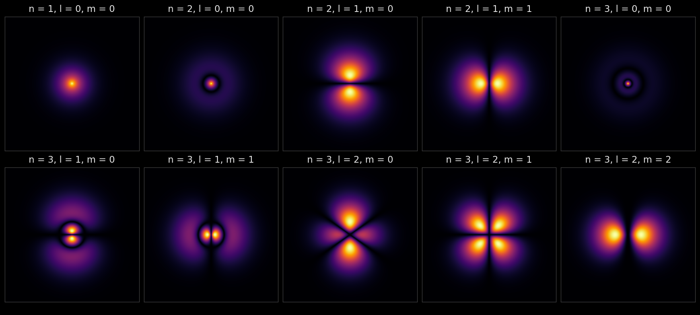

## Атомы

Вещество состоит из атомов. Но что такое атом?

::: {.nh-box size="lg"}
Атом — наименьшая электрически нейтральная единица данного химического элемента.
:::

::: {.nut-question}
Как устроен атом?
:::

## Как устроен атом

- В центре атома — положительно заряженное атомное ядро.
- В объёме атома — отрицательно заряженные электроны. Их суммарный заряд равен заряду ядра с обратным знаком.
- Химический элемент определяется зарядом атомного ядра.
- Масса атома в основном определяется атомным ядром.

## Как устроен атом

- Линейный размер атомного ядра примерно в 100 тысяч раз меньше размера атома.
- Объём ядра в $10^{15} = 1\,000\,000\,000\,000\,000$ раз меньше объёма атома.

::: {.fragment .nh-box tone="warning" size="lg"}
В основном атом состоит из пустоты.
:::

## Атом неделимый?

::: {.nut-cols .wide-right}
::: {.nut-figure}
{fig-alt="Гравюра с бюстом Демокрита" height="380"}

Демокрит, 460 до н. э.: «Делить можно лишь до неделимого — атома»

::: {.nut-credit}
Гравюра неизвестного автора, [Wikimedia Commons](https://commons.wikimedia.org/wiki/File:Democritus2.jpg), общественное достояние.
:::
:::

::: {}
- Представление Демокрита об атоме как о неделимом оказалось неверным.
- Атом можно разделить на атомное ядро и электроны.
:::
:::

## Где находятся электроны?

::: {.nut-cols}
::: {}
Популярная картина: электроны, как планеты, движутся вокруг ядра-Солнца.

Что в этой картинке не так?

::: {.fragment}
- электроны — это не шарики;
- электроны не движутся по орбитам, как планеты.
:::
:::

:::

## Где находятся электроны?

Описание атома корректно в рамках квантовой физики: правильно говорить об области, где электрон может быть обнаружен с той или иной вероятностью.

::: {.nut-figure}
{fig-alt="Распределение вероятности найти электрон в атоме водорода для разных состояний" height="520"}

::: {.nut-credit}
Атом водорода: где вероятнее всего найти электрон в разных состояниях. Ярче — вероятнее. Расчёт по решениям уравнения Шрёдингера; масштаб картинок разный.
:::
:::

## Что такое атом?

::: {.nh-box size="lg"}
Атом — это сложная устойчивая система: компактное ядро плюс электроны. Именно такая система является минимальным носителем химических свойств элемента.
:::

Описание атома возможно в рамках квантовой физики.
